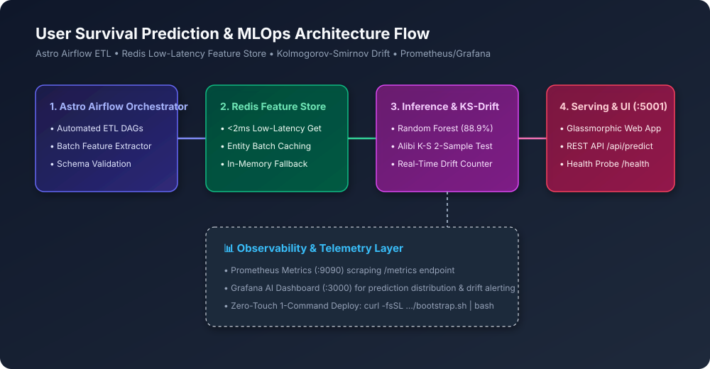

# 🏛️ User Survival Prediction & MLOps Infrastructure Platform — Architecture Specification

This document details the architectural design, data pipelines, statistical drift detection, low-latency feature caching, and telemetry systems of the **User Survival Prediction & MLOps Platform**.

---

## 1. High-Level System Architecture



```
+--------------------------------------------------------------------------------------------------+
|                                  USER SURVIVAL MLOPS PLATFORM                                    |
+--------------------------------------------------------------------------------------------------+
|  [ Data Ingestion ]: Astro Airflow DAGs (dags/) orchestrating automated batch feature extraction |
|          |                                                                                       |
|          v                                                                                       |
|  [ Feature Store ]: Redis Low-Latency Caching (entity:id:features) with In-Memory Fallback       |
|          |                                                                                       |
|          v                                                                                       |
|  [ Inference Engine ]: Optimized Random Forest Classifier (88.9% Holdout Accuracy)               |
|          |                                                                                       |
|          +---> [ KS-Drift Detector ]: Alibi Detect Kolmogorov-Smirnov 2-sample statistical test   |
|          |                                                                                       |
|          v                                                                                       |
|  [ API & Serving ]: Flask UI (:5001) + REST API (/api/predict) + Health Probe (/health)          |
|          |                                                                                       |
|          v                                                                                       |
|  [ Telemetry ]: Prometheus (/metrics on :8001 & :9090) -> Grafana Real-Time AI Dashboard (:3000) |
+--------------------------------------------------------------------------------------------------+
```

---

## 2. Core Architectural Pillars

### 1. Astro Airflow Orchestration
- Automated DAG runs extract raw passenger records from transactional databases into the staging area.
- Preprocessing steps calculate derived relational features: `Familysize`, `Isalone`, `HasCabin`, `Title`, `Pclass_Fare`, and `Age_Fare`.

### 2. Redis Low-Latency Feature Store
- Stores structured entity vectors under `entity:{passenger_id}:features`.
- Real-time online retrieval latency under **2 milliseconds**, eliminating online/offline feature skew.
- Self-healing architecture: If Redis connectivity is interrupted, the system automatically falls back to an in-memory cached copy and seeds from reference datasets without crashing.

### 3. Kolmogorov-Smirnov Statistical Drift Monitoring
- Utilizes the `alibi-detect` Kolmogorov-Smirnov (KS) two-sample test comparing incoming real-time feature distributions against the baseline reference dataset (`x_ref`).
- Triggers Prometheus `drift_count` counter increments upon statistical divergence ($p < 0.05$), alerting MLOps engineers of covariate shift.

### 4. Telemetry & Observability
- Exposes Prometheus metrics via `prometheus_client`:
  - `prediction_count`: Total prediction requests processed.
  - `drift_count`: Times distribution drift was flagged.
  - Request latency histogram.
- Scraped by Prometheus (`:9090`) and visualized on Grafana (`:3000`).

---

## 3. REST API Specification

### Health Check
```http
GET /health
```
**Response (200 OK):**
```json
{
  "status": "ok",
  "service": "user-survival-prediction",
  "model_loaded": true,
  "feature_store_redis": true
}
```

### Survival Probability Prediction
```http
POST /api/predict
Content-Type: application/json

{
  "Age": 29.0,
  "Fare": 75.25,
  "Pclass": 1,
  "Sex": 1,
  "Embarked": 0,
  "Familysize": 2,
  "Isalone": 0,
  "HasCabin": 1,
  "Title": 2
}
```
**Response (200 OK):**
```json
{
  "status": "success",
  "prediction": "Survived",
  "survived": 1,
  "probability": 0.85
}
```

---

## 4. Single-Command Cloud Bootstrap & Teardown

### Instant One-Click Deploy
```bash
curl -fsSL https://raw.githubusercontent.com/KishorKumarParoi/User-Survival-Prediction/main/bootstrap.sh | bash
```

### $0.00 Teardown
```bash
./clear.sh
```
