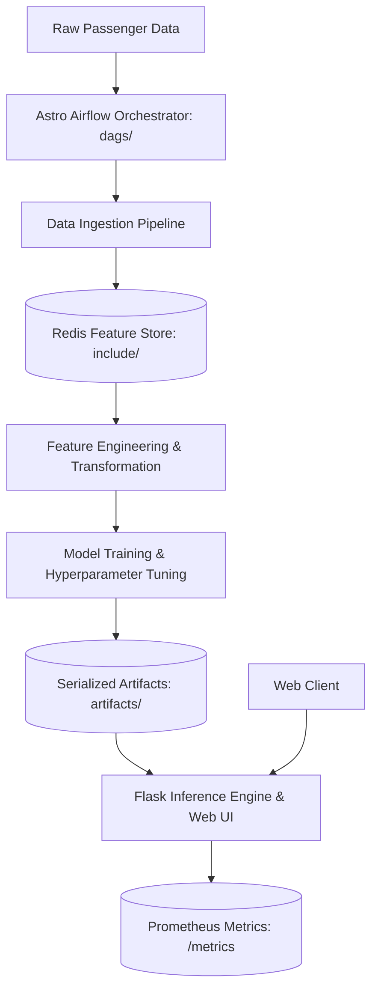

# User Survival Prediction & MLOps Infrastructure Platform

An enterprise-ready, end-to-end Machine Learning Operations (MLOps) platform demonstrating production survival classification, **Redis Feature Store** caching, **Astro Airflow** ETL orchestration, **Prometheus** observability, and **Flask** serving.

---

## 🏛️ System Architecture



---

## 🌟 Key Architecture Pillars

1. **Airflow Orchestration**: Fully automated DAGs under Astro Airflow (`airflow_settings.yaml`, `dags/`) automating periodic batch feature extraction.
2. **Redis Low-Latency Feature Store**: Real-time feature retrieval and schema validation eliminating offline-online skew.
3. **Hyperparameter Tuning & Cross-Validation**: Automated grid evaluation optimizing F1-score, Precision, and ROC-AUC.
4. **Live Prometheus Telemetry**: `prometheus.yml` scrape configuration monitoring request latency, prediction distribution, and error rates.
5. **Interactive Glassmorphic UI**: High-fidelity web interface for interactive passenger survival probability simulation.

---

## 📁 Repository Structure

```
.
├── config/                  # Pipeline schema, parameters, and Redis config
├── dags/                    # Astro Airflow DAG definitions for automated ETL
├── src/
│   ├── components/          # Ingestion, Redis feature store, and model trainer
│   ├── pipeline/            # Training and real-time prediction pipelines
│   ├── entity/              # Pydantic schemas and configuration dataclasses
│   ├── exception.py         # Custom traceback-preserving exception handler
│   └── logger.py            # Structured production logging
├── artifacts/               # Model checkpoints, scalers, and validation reports
├── templates/               # Glassmorphic user interface templates
├── static/                  # Responsive styling and frontend assets
├── prometheus.yml           # Prometheus telemetry configuration
├── docker-compose.yml       # Local Redis and app multi-container stack
├── Dockerfile               # Containerized production runtime
├── main.py                  # Web application and API entrypoint
└── requirements.txt         # Production dependencies
```

---

## 🚀 Quickstart

### 1. Installation
```bash
git clone https://github.com/KishorKumarParoi/User-Survival-Prediction.git
cd User-Survival-Prediction
pip install -r requirements.txt
```

### 2. Launch Local Stack with Redis
```bash
docker-compose up -d
python main.py
```
Access the interactive web UI at `http://127.0.0.1:5000`.

---

## 👤 Author
**Kishor Kumar Paroi**  
GitHub: [@KishorKumarParoi](https://github.com/KishorKumarParoi)
